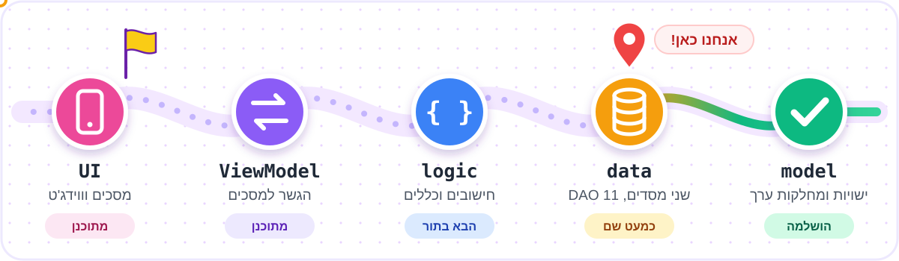
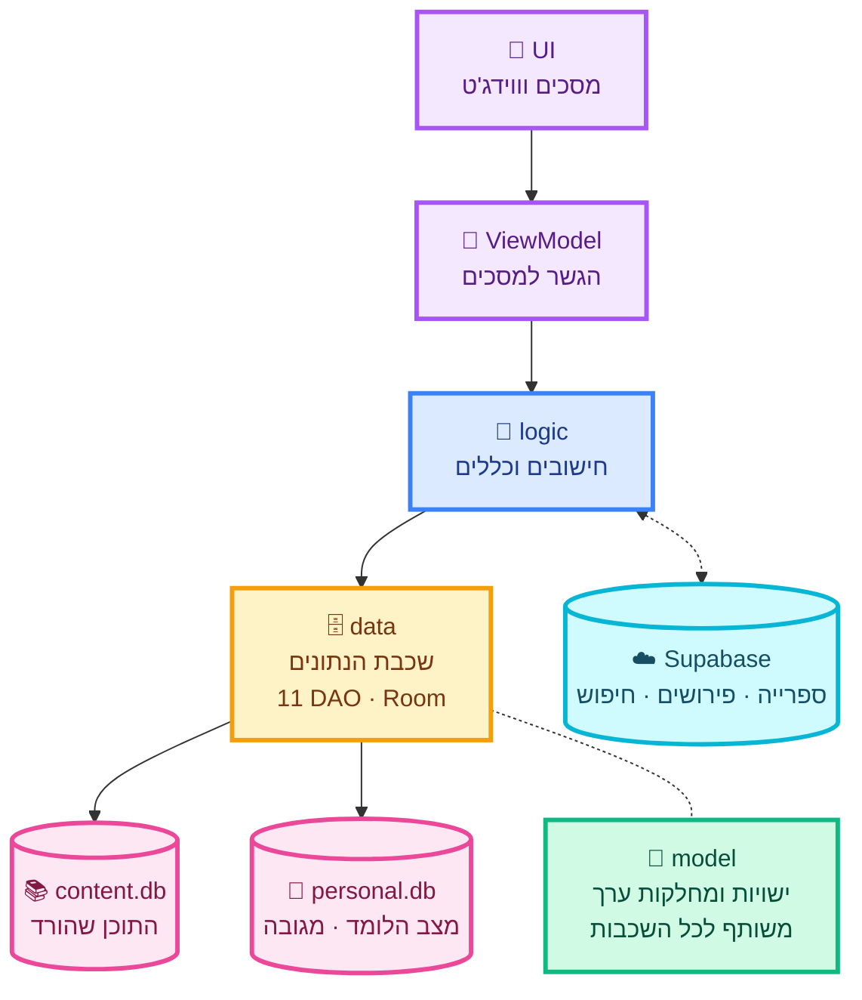
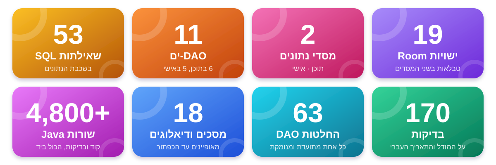
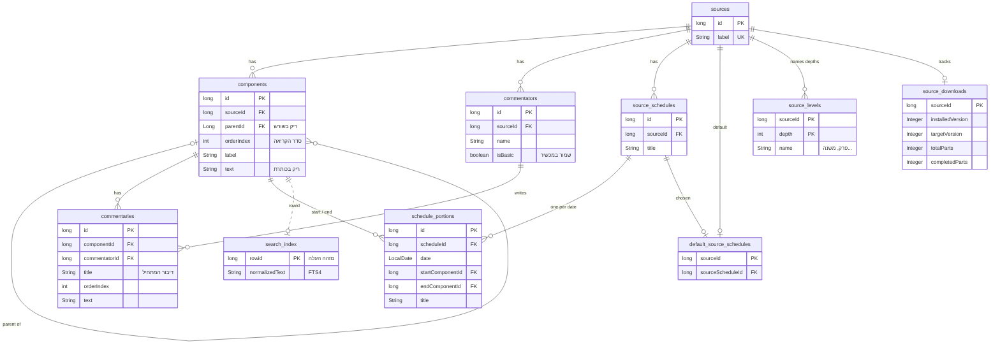
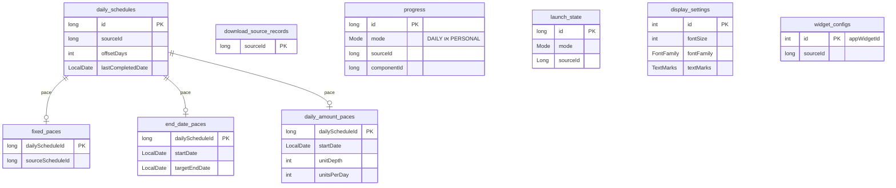
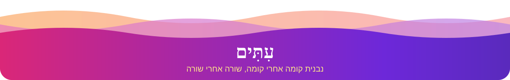

<p align="right"><sub>בס״ד</sub></p>

<p align="center">
  
</p>

<p align="center">
  
  
  
  
  
  
</p>

<p align="center" dir="rtl">
  <a href="#about">🕰️ מה זה</a> &nbsp;•&nbsp;
  <a href="#paces">🎚️ קצבים</a> &nbsp;•&nbsp;
  <a href="#features">✨ יכולות</a> &nbsp;•&nbsp;
  <a href="#journey">🗺️ המסע</a> &nbsp;•&nbsp;
  <a href="#numbers">📊 במספרים</a> &nbsp;•&nbsp;
  <a href="#engine">🧠 מתחת למכסה</a> &nbsp;•&nbsp;
  <a href="#hats">🎩 שיטת העבודה</a>
</p>


<div dir="rtl">

<a id="about"></a>

## 🕰️ מה זה עתים?

**עתים** עוזרת לקבוע זמן קבוע ללימוד תורה, בכל יום.
בוחרים מקור, למשל תורה, נ״ך, משנה או מסילת ישרים, ולומדים אותו באחד משני מסלולים:

<table>
  <tr>
    <td width="50%" align="center" valign="top">
      <h3>📅 המסלול היומי</h3>
      הספק מוכן לכל תאריך, כמו כל מי שלומד לפי אותו לוח.<br>
      פספסת יום? אפשר להשלים, בלי לחץ.
    </td>
    <td width="50%" align="center" valign="top">
      <h3>🚶 המסלול האישי</h3>
      בקצב שלך, בלי תאריכים.<br>
      סוגרים את האפליקציה, וחוזרים בדיוק למקום שבו עצרת.
    </td>
  </tr>
</table>

**ובלי רעשי רקע 🤫** אין חשבונות, אין התחברות, אין פיד ואין התראות. כל לומד הוא אורח, והלימוד עובד גם בלי רשת.

> 💡 **למה ״עתים״?**
> הגמרא מונה את השאלות ששואלים אדם כשהוא בא לדין, ואחת מהן היא: ״קָבַעְתָּ עִתִּים לַתּוֹרָה?״ (שבת לא, א).
> עתים רוצה לעזור שהתשובה תהיה ״כן״ 🙂

<a id="paces"></a>

## 🎚️ שלושה קצבים, והלומד בוחר

במסלול היומי, לכל מקור יש קצב משלו:

<table>
  <tr>
    <td width="33%" align="center" valign="top">
      <h3>🗓️ לוח קבוע</h3>
      לוח מוכן שמגיע עם המקור: פרק ליום, משנה ליום ועוד.<br>
      למקור יכולים להיות כמה לוחות, ואחד מהם הוא ברירת המחדל.
    </td>
    <td width="33%" align="center" valign="top">
      <h3>🎯 עד תאריך</h3>
      בוחרים תאריך סיום, והאפליקציה מחלקת את כל המקור עד אליו.<br>
      למשל: לסיים שולחן ערוך בחצי שנה.
    </td>
    <td width="33%" align="center" valign="top">
      <h3>🔢 כמות ביום</h3>
      מספר קבוע של יחידות בכל יום.<br>
      למשל: שני פרקים, או שלוש משניות.
    </td>
  </tr>
</table>

✂️ החלוקה נחתכת רק בסוף פסוק, משנה או סעיף, ונקבעת מראש ולא לפי אורך הטקסט. כך קל לזכור אותה, ואפשר ללמוד לפיה גם מתוך ספר רגיל 📖

⏪ פיגרת? ממשיכים מאותו מקום, והחלוקה לא זזה.

<a id="features"></a>

## ✨ מה יהיה בה

<table>
  <tr>
    <td width="50%" valign="top">
      <b>📅 הספק יומי ולוח שנה עברי</b><br>
      ההספק של היום, הצצה בימים אחרים בלוח שנה עברי, והצעה עדינה להשלים אחרי ימים שפוספסו.
    </td>
    <td width="50%" valign="top">
      <b>📖 קריאה רציפה</b><br>
      כל מקור נגלל כטקסט אחד ארוך, והמקום נשמר לבד.
    </td>
  </tr>
  <tr>
    <td valign="top">
      <b>💬 פירושים בלחיצה</b><br>
      לוחצים על פסוק ומקבלים את הפירושים עליו: הבסיסיים שמורים במכשיר, והנוספים מגיעים מהשרת.
    </td>
    <td valign="top">
      <b>🔍 חיפוש</b><br>
      הצעות לפי שם תוך כדי הקלדה (״נגעים״ ← מסכת נגעים), חיפוש בטקסט המלא בשרת, ובתנ״ך גם בלי רשת.
    </td>
  </tr>
  <tr>
    <td valign="top">
      <b>⬇️ ספרייה</b><br>
      מורידים מקורות נוספים בחלקים, עם השהיה והמשך. ההורדה ממשיכה גם ברקע.
    </td>
    <td valign="top">
      <b>🏠 ווידג'ט</b><br>
      ההספק של היום על מסך הבית: לא התחלת, באמצע, או סיימת.
    </td>
  </tr>
  <tr>
    <td valign="top">
      <b>🔤 תצוגה לבחירתך</b><br>
      שלושה גופנים עבריים, גודל טקסט, וסימנים: ניקוד וטעמים, רק ניקוד, או בלי.
    </td>
    <td valign="top">
      <b>📱 טלפון חדש? אותו מקום</b><br>
      המקום וההגדרות עוברים בגיבוי של אנדרואיד, והמקורות יורדים מחדש לבד.
    </td>
  </tr>
</table>

🌗 הכול בעברית, מימין לשמאל, ובמצב בהיר או כהה לפי המכשיר.

</div>


<div dir="rtl">

<a id="journey"></a>

## 🗺️ המסע: איפה אנחנו

עתים נבנית מלמטה למעלה, קומה אחרי קומה. כל קומה נשענת רק על מה שמתחתיה, ולא מתחילים קומה חדשה לפני שהקודמת גמורה.

</div>

<p align="center">
  
</p>

<div dir="rtl">

- ✅ **model**: ‏19 ישויות, מחלקות ערך ו-enums. הושלמה ונסגרה ב-22 באוקטובר 2026.
- 🚧 **data**: הקוד של שני המסדים ו-11 ה-DAO נכתב בנובמבר 2026. עכשיו: בדיקות.
- 🔜 **logic**: התכנון כבר בדרך: מפת דרכים, 22 שאלות לצוות ההחלטות, וחוזה של 28 סעיפים ששכבת הנתונים משאירה לה.
- ⏳ **ViewModel** ו-**UI**: אחר כך.

### 🔌 איך הכול מתחבר

</div>




<div dir="rtl">

<a id="numbers"></a>

## 📊 עתים במספרים

</div>

<p align="center">
  
</p>

<p align="center" dir="rtl"><sub>נכון לנובמבר 2026. המספרים עוד יגדלו 🌱</sub></p>


<div dir="rtl">

<a id="engine"></a>

## 🧠 מתחת למכסה המנוע

- 🧊 **הכול קפוא.** כל מחלקה `final`, כל שדה `final`, ואין אף setter. רוצים לשנות? יוצרים אובייקט חדש. ו-Room בונה כל שורה דרך הבנאי, אז הבדיקות שבבנאי רצות גם בכל קריאה מהמסד.
- 🌳 **עץ אחד לכל ספר.** ספר, פרק, פסוק, משנה או סעיף: הכול `Component` בעץ אחד, שבו כל רכיב מכיר את האב שלו ואת מקומו בסדר הקריאה. ספר חדש נכנס כנתונים בלבד, בלי שורת קוד.
- 🔗 **המקום שלך שורד הכול.** מחקת מקור והורדת אותו שוב? ממשיכים בדיוק מאותו מקום. המזהים מגיעים מהשרת, ולעולם לא משתנים ולא ממוחזרים.
- 📆 **לוח עברי בלי בלבול.** `HebrewDate` עוטפת את `HebrewCalendar` של ICU ומסתירה את המספור המבלבל שלו (אדר א' תופס מקום גם בשנה רגילה) מאחורי מספור פשוט: חודשים 1 עד 14, מניסן.
- 🔎 **חיפוש בלי רשת.** טבלת FTS4 שומרת עותק מנורמל של הטקסט, בלי ניקוד, בלי טעמים ובלי אותיות סופיות, כך ש״בְּרֵאשִׁית״ ו״בראשית״ נמצאים באותו חיפוש.
- ⚡ **מ-14 שניות ל-0.11.** כל עמודת מפתח זר מכוסה באינדקס. בניסוי על SQLite, מחיקת מקור של כ-30,000 רכיבים ירדה מ-14 שניות ל-0.11 שניות.
- 🧵 **ה-DAO לא נוגע ב-threads.** קריאה חד-פעמית מחזירה `ListenableFuture`, קריאה חיה מחזירה `LiveData`, ו״היום״ תמיד מגיע מבחוץ: אין `date('now')` ב-SQL.

### 🗄️ שני מסדים, ולכל אחד תפקיד

| | 📚 מסד התוכן `content.db` | 💾 המסד האישי `personal.db` |
|---|---|---|
| **מה יש בו** | המקורות, עץ הטקסט, הפירושים, לוחות ההספקים, מצב ההורדות ואינדקס החיפוש | המקום בלימוד, הקצב והתאריכים, הגדרות התצוגה, הווידג'טים ורשימת המקורות שהורדו |
| **טבלאות** | 10 | 9 |
| **גיבוי של אנדרואיד** | ❌ לא. תמיד אפשר להוריד אותו מחדש, והוא גדול ממגבלת הגיבוי (25 MB) | ✅ כן. זה מה שעובר איתך לטלפון חדש |

אין מפתח זר שעובר בין שני המסדים. המסד האישי מפנה לתוכן לפי מזהים יציבים בלבד.

</div>


<div dir="rtl">

<a id="hats"></a>

## 🎩 שלושה כובעים, מפתח אחד

את עתים בונה מפתח יחיד, שמחליף כובעים. כל כובע עושה רק את העבודה שלו:

<table>
  <tr>
    <td width="33%" align="center" valign="top">
      <h3>🧠 המחליט</h3>
      מקבל החלטות, ורק החלטות.<br>
      כל אחת נרשמת ביומן ההחלטות, עם הנימוק שלה.
    </td>
    <td width="33%" align="center" valign="top">
      <h3>📝 המאפיין</h3>
      הופך החלטות לאפיון מדויק: שמות, חתימות ושאילתות SQL.<br>
      לא מחליט כלום.
    </td>
    <td width="33%" align="center" valign="top">
      <h3>💻 המתכנת</h3>
      כותב את הקוד לפי האפיון, ובודק אותו.<br>
      גם הוא לא מחליט כלום.
    </td>
  </tr>
</table>

ככה אף שורת קוד לא נכתבת כשעוד יש שאלה פתוחה, וכשכותבים קוד לא צריך לעצור באמצע ולהחליט.

📒 החלטה ← 📝 אפיון ← 💻 קוד ← 🧪 בדיקות

🤖 **Claude** עוזר בכל שלב: מציג אפשרויות להחלטה, כותב אפיון מורחב ובודק את הקוד. את הקוד עצמו כותבים ביד, שורה אחרי שורה ✍️

👀 רוצים לראות איך נראה אפיון? הנה האפיון של שכבת הנתונים: [`docs/dao/dao-spec.md`](docs/dao/dao-spec.md)

## 🌍 המשפחה של עתים

האפליקציה היא רק חלק אחד מהתמונה:

<table>
  <tr>
    <td width="33%" align="center" valign="top">
      <h3>📱 האפליקציה</h3>
      אפליקציית האנדרואיד.<br>
      מה שנבנה כאן, עכשיו.
    </td>
    <td width="33%" align="center" valign="top">
      <h3>🛠️ כלי הניהול</h3>
      הוספת מקורות לספרייה, בניית לוחות הספקים ופרסום גרסאות.
    </td>
    <td width="33%" align="center" valign="top">
      <h3>🌐 האתר</h3>
      אתר פשוט ללומדים.
    </td>
  </tr>
</table>

☁️ ובאמצע, שרת **Supabase**: ספריית המקורות, קריאה מקוונת, פירושים נוספים וחיפוש בטקסט מלא.

## 🧰 בנוי עם

| | כלי | בשביל מה |
|:---:|---|---|
| ☕ | **Java 11** | כל הקוד, בלי Kotlin |
| 🤖 | **Android** · compileSdk 37 · minSdk 24 | רץ מאנדרואיד 7.0 ומעלה |
| 🗄️ | **Room 2.8.5** + SQLite FTS4 | שני מסדים מקומיים וחיפוש בלי רשת |
| 🔮 | **Guava** `ListenableFuture` + `LiveData` | קריאות ברקע וקריאות חיות |
| 📆 | `java.time` + ICU `HebrewCalendar` | תאריכים לועזיים ועבריים |
| 🧪 | **JUnit** + **Robolectric** | בדיקות |
| ☁️ | **Supabase** | השרת |

## 📂 מבנה הקוד

</div>

```text
com.itim.app
├── 🧊 model          ✅ הנתונים עצמם
│   ├── content          ← מה לומדים
│   ├── distribution     ← איך התוכן מגיע למכשיר
│   ├── state            ← איפה הלומד נמצא
│   ├── settings         ← איך הטקסט נראה
│   └── hebrew           ← תאריך עברי וחיפוש
├── 🗄️ data           🚧 שכבת הנתונים
│   ├── content          ← ContentDatabase + 6 DAOs
│   └── personal         ← PersonalDatabase + 5 DAOs
└── 🧠 logic          🔜 הבא בתור
```

<details>
<summary dir="rtl">🔬 <b>לסקרנים: כל הטבלאות (לחצו לפתיחה)</b></summary>

<h3 dir="rtl">📚 מסד התוכן</h3>



<h3 dir="rtl">💾 המסד האישי</h3>



</details>

<!--
## 📸 צילומי מסך

להוסיף כאן כשהממשק יהיה מוכן. קבצים מוצעים:
docs/images/daily.png, docs/images/calendar.png, docs/images/search.png, docs/images/widget.png

<p align="center">
  
  
  
  
</p>
-->

<br>

<p align="center">
  
</p>

<p align="center" dir="rtl">
  אהבתם? ⭐ קטן עושה שמח
</p>
