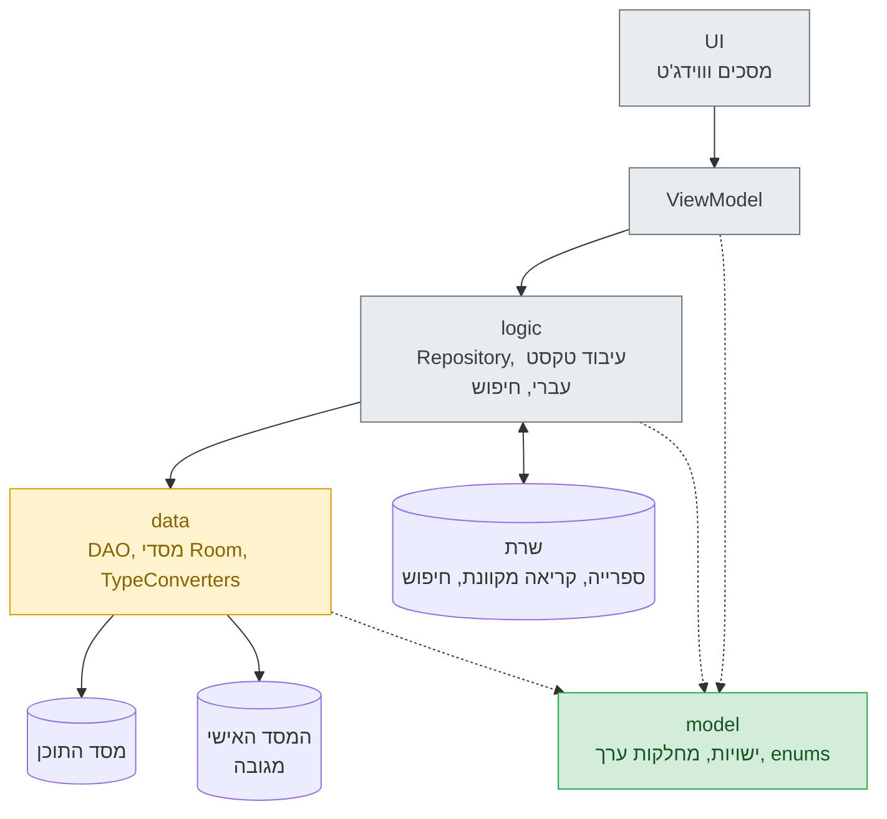
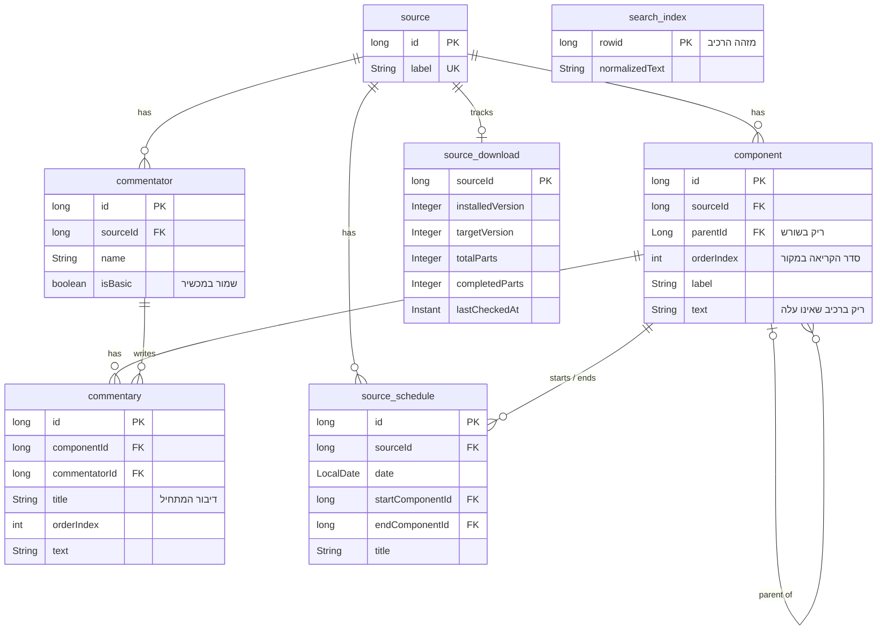
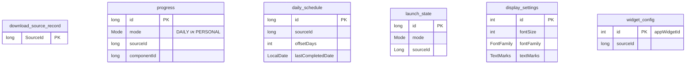

# עִתִּים

**אפליקציית אנדרואיד ללימוד תורה יומי**

*"קָבַעְתָּ עִתִּים לַתּוֹרָה?"* (שבת לא, א)

---

## על האפליקציה

עתים עוזרת ללומד לקבוע זמן קבוע ללימוד תורה בכל יום.
הלומד בוחר מקור, למשל תורה, נ"ך, משנה או מסילת ישרים, ולומד אותו באחד משני מסלולים:

- **לימוד יומי:** הספק קבוע לכל תאריך, כמו כל מי שלומד לפי אותו לוח.
- **לימוד אישי:** בקצב של הלומד, וממשיכים בדיוק מהמקום שבו עצר.

האפליקציה בנויה לריכוז: אין חשבונות, אין התחברות, אין פיד ואין התראות. כל לומד הוא אורח, וכל הלימוד עובד גם בלי רשת.

## יכולות מתוכננות

| | יכולת | פירוט |
|---|---|---|
| 📅 | **הספק יומי** | הספק לכל תאריך, לוח שנה עברי, הצצה בימים אחרים, והצעה עדינה להשלים אחרי ימים שפוספסו |
| 📖 | **קריאה רציפה** | טקסט אחד שנגלל ברצף לכל מקור, והמקום נשמר אוטומטית |
| 💬 | **פירושים** | לחיצה על פסוק פותחת את הפירושים עליו: הבסיסיים שמורים במכשיר, והנוספים נטענים מהשרת |
| 🔍 | **חיפוש** | הצעות לפי שם תוך כדי הקלדה ("ברכות" מציע את מסכת ברכות), חיפוש בטקסט המלא בשרת, וחיפוש בתנ"ך גם בלי רשת |
| ⬇️ | **ספרייה** | הורדת מקורות נוספים בחלקים, עם השהיה והמשך, ועדכון שקט ברקע לגרסאות חדשות |
| 🏠 | **ווידג'ט** | ההספק של היום והמצב שלו (לא התחיל, בעיצומו, הושלם) עבור מקור שבוחרים |
| 🔤 | **הגדרות תצוגה** | שלושה גופנים עבריים, גודל טקסט, וניקוד וטעמים לפי בחירה |
| 📱 | **טלפון חדש, אותו מקום** | המקום וההגדרות משוחזרים מהגיבוי של אנדרואיד, והמקורות יורדים מחדש אוטומטית |

הממשק כולו בעברית, מימין לשמאל, ומתאים את עצמו לערכת הצבעים (בהירה או כהה) של המכשיר.

## ארכיטקטורה

האפליקציה נבנית מלמטה למעלה, שכבה אחר שכבה. כל שכבה תלויה רק בשכבות שמתחתיה.

### שני מסדי נתונים מקומיים

הנתונים במכשיר מחולקים לשני מסדי SQLite, ש-Room מנהל:

| מסד | מה יש בו | גיבוי של אנדרואיד | למה |
|---|---|---|---|
| **מסד התוכן** | המקורות, עץ הטקסט שלהם, הפירושים, לוחות ההספק, מצב ההורדות ואינדקס החיפוש | לא מגובה | תמיד אפשר להוריד אותו מחדש, והוא גדול ממגבלת הגיבוי האוטומטי (25 MB) |
| **המסד האישי** | המקום בלימוד, התאריכים של הלומד, הגדרות התצוגה, הווידג'טים ורשימת המקורות שהורדו | מגובה | נוצר במכשיר ואי אפשר לשחזר אותו מחדש, ולכן הוא מה שעובר לטלפון חדש |

אין מפתחות זרים בין שני המסדים. הנתונים האישיים מפנים לתוכן לפי מזהים יציבים, שהשרת מקצה ולעולם לא ממחזר. לכן מי שמוחק מקור ומוריד אותו שוב ממשיך מאותו מקום.

### מבנה מסד התוכן

### מבנה המסד האישי

## נקודות הנדסיות

- **מודל בלתי משתנה.** כל המחלקות `final`, כל השדות `final`, ואין אף setter. Room בונה כל שורה דרך הבנאי, ולכן הבדיקות שבבנאי רצות גם בכל קריאה מהמסד, ולא רק בכתיבה.
- **עץ אחד לכל ספר.** כל מבנה, ספר, פרק, פסוק, משנה או סעיף, נשמר כעץ אחד של `Component`, שבו כל רכיב מכיר את האב שלו ואת מקומו בסדר הקריאה. מקור חדש נוסף כנתונים בלבד, בלי שורת קוד, ושאילתה אחת שולפת קטע רציף יחד עם הכותרות שלו.
- **לוח עברי בלי בלבול.** `HebrewDate` עוטפת את `HebrewCalendar` של ICU באנדרואיד ומסתירה את מספור החודשים המבלבל שלו (אדר א' תופס מקום גם בשנה רגילה) מאחורי מספור אחד וברור: חודשים 1 עד 14, מניסן.
- **חיפוש בלי רשת.** טבלת FTS4 של SQLite שומרת עותק מנורמל של הטקסט, בלי ניקוד, בלי טעמים ובלי אותיות סופיות, כך ש"בְּרֵאשִׁית" ו"בראשית" נמצאים באותו חיפוש.
- **אינדקסים שנמדדו.** כל עמודת מפתח זר מכוסה באינדקס. בניסוי על SQLite, מחיקת מקור של כ-30,000 רכיבים ארכה 14 שניות בלי האינדקסים על טבלת לוח ההספק, ו-0.11 שניות איתם.
- **פיתוח לפי אפיון.** כל שכבה נבנית מאפיון כתוב ומיומן החלטות. העבודה מחולקת לשלושה תפקידים נפרדים, החלטה, אפיון ותכנות, כך שאף שורת קוד לא נכתבת כל עוד שאלת תכנון עדיין פתוחה.

## סטטוס

| שכבה | מצב |
|---|---|
| model: ‏13 ישויות, 5 מחלקות ערך, 6 enums | ✅ הושלמה ונסגרה |
| data: ‏DAO, מסדי Room, TypeConverters | 🚧 בעבודה |
| logic: ‏Repository, עיבוד טקסט, חיפוש | ⏳ מתוכננת |
| ViewModel | ⏳ מתוכננת |
| UI: מסכים ו-ווידג'ט | ⏳ מתוכננת |

## מבנה הקוד

שכבת ה-model נמצאת בחבילה `com.itim.app.model`, וכל תחום הוא תת-חבילה משלו:

| חבילה | השאלה שהיא עונה עליה | מחלקות |
|---|---|---|
| `content` | מה לומדים | `Source`, `Component`, `Commentator`, `Commentary`, `SchedulePortion` |
| `distribution` | איך התוכן מגיע למכשיר | `SourceDownload`, `LibraryItem`, `ReleaseStatus` |
| `state` | איפה הלומד נמצא | `Progress`, `DailySchedule`, `LaunchState`, `DownloadSourceRecord`, `DailyStatus`, `Mode` |
| `settings` | איך הטקסט מוצג | `DisplaySettings`, `WidgetConfig`, `FontFamily`, `TextMarks` |
| `hebrew` | תאריך עברי וחיפוש | `HebrewDate`, `SearchIndex`, `SearchResult`, `SearchSuggestion` |

## טכנולוגיות

- **שפה:** Java
- **פלטפורמה:** Android
- **אחסון:** Room מעל SQLite, כולל FTS4 לחיפוש בטקסט מלא
- **תאריכים:** `java.time` ו-ICU של אנדרואיד (`android.icu.util.HebrewCalendar`)
- **שרת:** Supabase, לספריית המקורות, לקריאה מקוונת, לפירושים ולחיפוש בטקסט מלא

<!--
## צילומי מסך

להוסיף כאן כשהממשק יהיה מוכן. קבצים מוצעים:
docs/images/daily.png, docs/images/calendar.png, docs/images/search.png, docs/images/widget.png

  
  
  
  

-->
